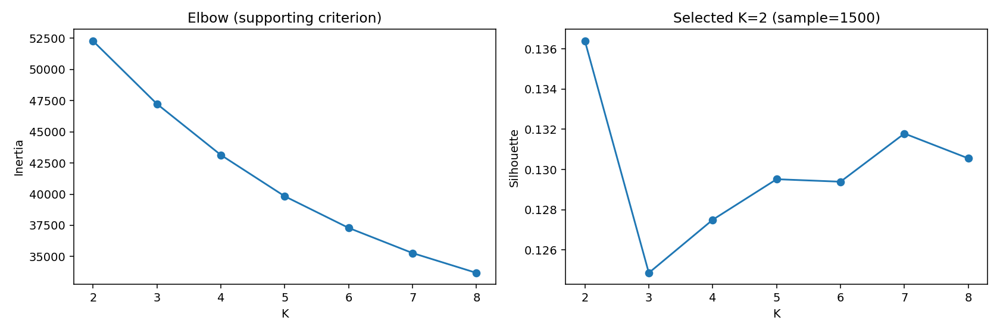
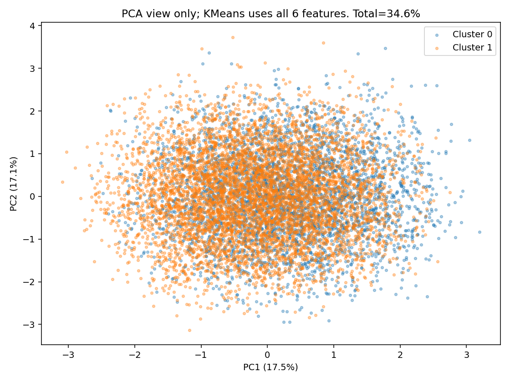
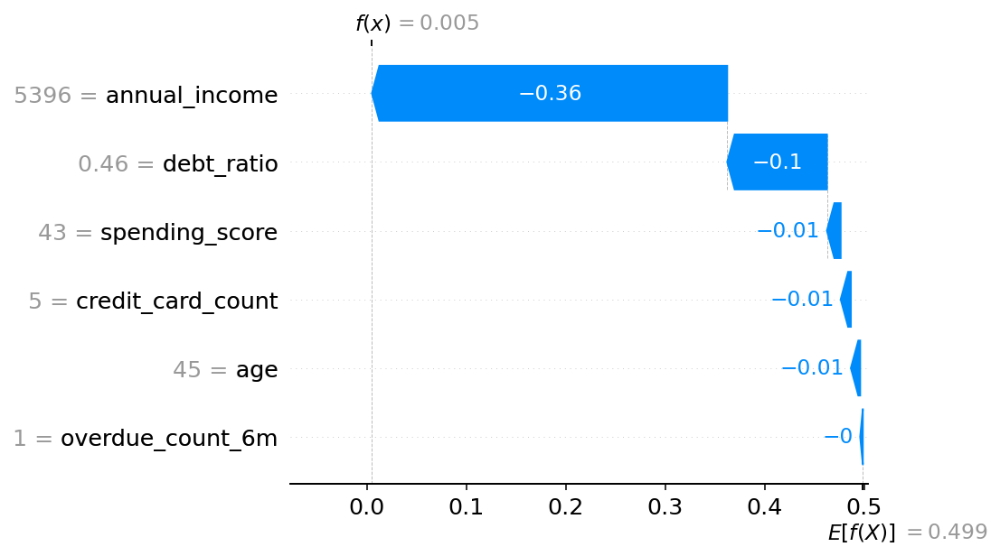
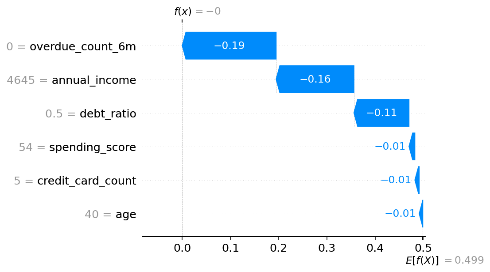
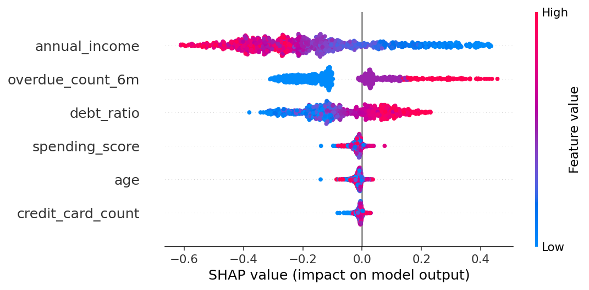
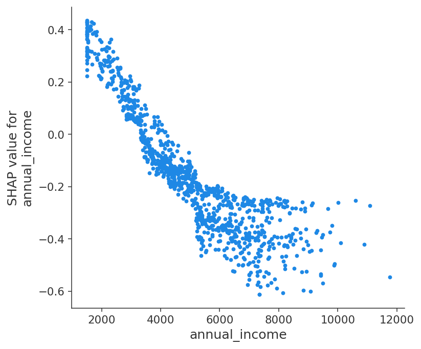
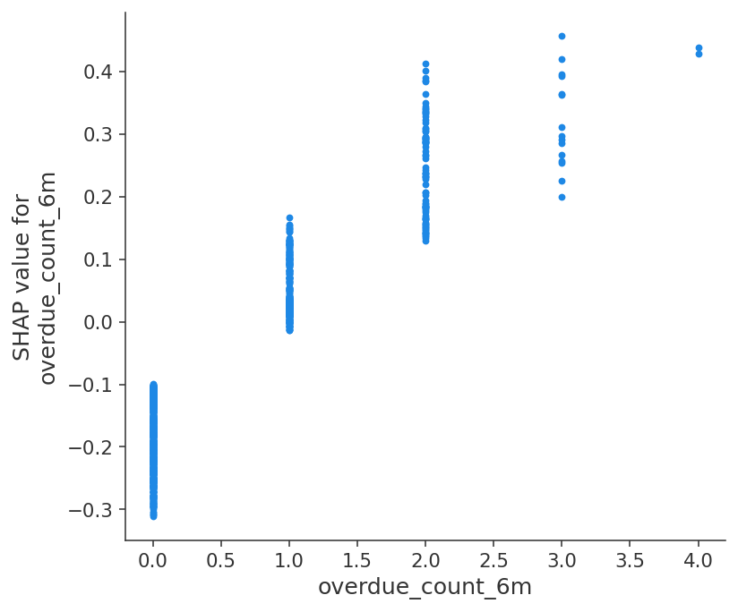
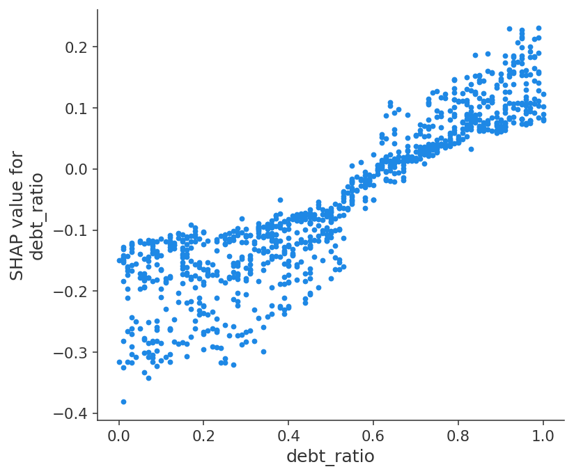
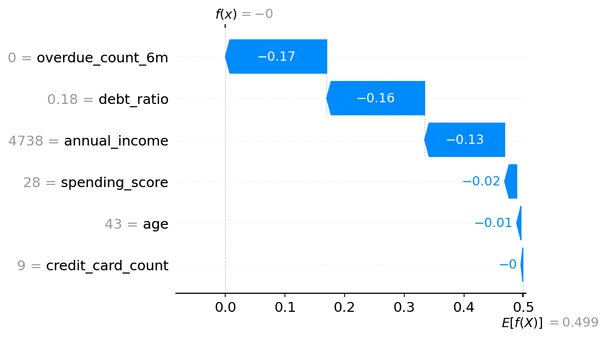
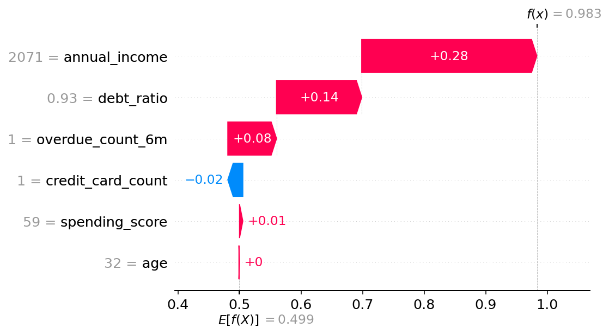

# A5-2: 고객 군집화와 설명 가능한 연체 예측

## 1. 문제 / 목표

원본 가상 금융 고객 10,000명의 입력 6개로 페르소나를 탐색하고 이전 미션의 Random Forest로 예측한 연체 확률을 TreeSHAP으로 설명한다. 각 미션 폴더는 독립적이다. 원본 CSV와 학습 모델을 이 폴더 내부로 복사했으며 실행 시 다른 미션의 코드·데이터를 참조하지 않는다.

PDF의 거절 확률 `5 이상`은 확률 범위 [0,1]을 벗어나므로 `0.5 이상`으로 명시적으로 정정하였다. 보너스의 이탈 확률 예시는 실제 타겟 `is_overdue`인 연체 확률로 표시한다. 타겟·데이터 컬럼을 새로 추가하지 않았다.

### 설치 및 실행

Python 3.12 / conda py312에서 검증했다. `requirements.txt`에는 scikit-learn·SHAP 버전을 포함한 직접 의존성을 기록했다. 복사된 모델 파일은 이 과제에서 생성한 신뢰하는 로컬 artifact다.

```bash
conda activate py312
cd A5-2
python -m pip install -r requirements.txt
python -m pytest tests -q
python analysis_clustering.py
python analysis_shap.py
python bonus_compare.py
python scripts/build_docs.py
python -m streamlit run app.py
```

실행 순서는 군집화 → SHAP → README/HTML 재생성이다. `models/random_forest.joblib`은 이전 미션 Train 분할에서 학습한 sklearn 전처리+RF Pipeline이다. 원본 SHA-256: `4ddf83dd154ee23bb2374a2bbc1aa56d537ef7ad5114c2f162078756542fe1a2`; 모델 SHA-256: `103e029e64935abb3c8521112b67451c14fcfc0f039c774092bf75d0077f0efb`.

평가자가 읽을 순서는 [코드 설명](docs/code_walkthrough.md), [도식·수식·실제 코드 HTML](docs/code_walkthrough.html), [실험 JSON](reports/shap.json)이다. README HTML은 [README.html](README.html)이다.

## 2. 군집 요약

K=2~8을 조사했다. Silhouette 우선 기준으로 K=2를 선택했고 점수는 0.136391다. Elbow는 감소가 점차 완만하지만 명확한 꺾임은 약하므로 확정적 최적 K라고 단정하지 않는다. Silhouette는 seed42로 1,500행을 표본화했고 KMeans는 전체 10,000행, 6차원, n_init=10이다.

|K|Inertia|Silhouette (동일 1,500 표본)|

|---|---|---|

|2|52274.245|0.136391|

|3|47231.890|0.124862|

|4|43140.456|0.127503|

|5|39830.627|0.129519|

|6|37296.417|0.129396|

|7|35279.321|0.131790|

|8|33690.807|0.130556|




|군집|인원|나이 평균|소득 평균(만원)|소비 점수|부채비율|카드 수|6개월 연체 평균|

|---|---|---|---|---|---|---|---|

|0|3931|44.81|5054.32|50.49|0.506|5.05|1.287|

|1|6069|44.50|5020.15|49.48|0.498|5.00|0.000|

PCA 설명된 분산은 PC1=17.47%, PC2=17.13%, 합=34.61%다. PC는 원본 특성의 가중 합이고 소득·나이 한 가지가 아니다. 2D는 정보 약 65.39%를 생략하므로 화면의 겹침만으로 6차원 군집을 판정하지 않는다.




## 3. 페르소나 정의

### 군집 0: 과거 연체 경험군

3,931명, 최근 6개월 연체 평균 1.287회이며 소득 5,054만원·부채 .506이다. 다른 군집과 나이·소득 차이는 작아서 VIP·저소득군으로 이름 붙일 근거가 약하다.

상환 일정 점검과 자동 결제 안내를 우선 제안한다. 연체 경험만으로 자동 거절하지 않고 현재 입력의 모델 예측과 별도로 해석한다.

대표 행 6225는 중심에 가장 가까운 실제 고객이며 소득 5,396만원, 연체1회, 부채 .46, 연체 확률 .0051(승인)이다. 소득 기여 −.3574가 전체 위험을 크게 낮추므로 군집 명칭이 예측 판정과 동일하지 않다.




### 군집 1: 최근 연체 이력 없음군

6,069명, 최근 연체 평균 0회이며 소득 5,020만원·부채 .498이다. 이 군집의 최근 연체0회는 실제 관측 통계이고 미래 연체가 절대로 없다는 뜻은 아니다.

기본 결제 관리와 상황 변화 시 재상담 안내를 제안한다. 소득·부채 확인을 생략하지 않는다.

대표 행2707은 소득4,645만원·연체0회·부채 .5, 예측확률0이며 최근 연체 기여 −.1947이 크다. 대표 한 명의 설명을 6,069명 전원에게 그대로 복사하면 안 된다.




## 4. Global SHAP 해석

TreeExplainer, 클래스1 연체 확률 출력, 실제 1,000행 seed42 표본이다. 최대 SHAP 덧셈 오차 9.714e-15로 1e-7 기준을 통과했다. 기준값 약 .4989는 class-balanced RF와 TreeExplainer 배경의 모델 출력 기준이지 실제 CSV 연체율 12.01% (1,201/10,000)가 아니다.

|상위 변수|평균 절대 SHAP|낮은 사분위 평균 기여|높은 사분위 평균 기여|

|---|---|---|---|

|annual_income|0.247173|+0.175546|-0.383653|

|overdue_count_6m|0.149772|-0.179568|+0.101991|

|debt_ratio|0.117827|-0.189841|+0.105248|




### Dependence: annual_income

낮은 소득 사분위 평균 기여 +.1755, 높은 소득 사분위 −.3837으로 이 모델에서는 소득이 높을 때 연체 위험을 낮추는 경향이 보인다. 소득 확인과 상환 능력 상담의 우선순위를 제안하되 이 관계는 합성 타겟 생성 규칙의 영향을 크게 받으며 임금 인상의 인과 효과가 아니다.




### Dependence: overdue_count_6m

최근 연체 횟수의 낮은 사분위 기여 −.1796, 높은 사분위 +.1020으로 과거 이력이 모델 위험을 높이는 경향이 보인다. 연체 이력군에 상환 일정 점검을 제안하지만 같은 횟수에서 기여가 달라질 수 있으므로 단독 거절 규칙으로 바꾸지 않는다.




### Dependence: debt_ratio

낮은 부채 사분위 기여 −.1898, 높은 사분위 +.1052로 고부채가 모델 위험을 높이는 경향이 보인다. 부채 상환 상담을 우선 안내하되 고객별 소득·연체 정보와 함께 보고 상담 효과는 별도 검증한다.




## 5. Local 사례 2건

전체 고객 예측 확률의 최소와 최대 행을 선정했다. 관측 타겟을 선정 기준으로 사용하지 않았고 교육용 임계값 .5로 판정했다. 극단 사례는 해석을 선명하게 하지만 보통 고객의 대표 사례는 아니다.

### 승인: 행 6 / 연체 확률 0.000000

원본 입력: age=43, annual_income=4738, spending_score=28, debt_ratio=0.18, credit_card_count=9, overdue_count_6m=0.

실제 타겟은 0이며 모델 판정과 별개의 관측 값이다. 기준 0.498882에 아래 6개 기여를 더하면 출력 확률이 된다.

|입력|SHAP 기여 (연체 확률 단위)|

|---|---|

|age|-0.007094|

|annual_income|-0.134185|

|spending_score|-0.020197|

|debt_ratio|-0.164248|

|credit_card_count|-0.003256|

|overdue_count_6m|-0.169904|




### 거절: 행 576 / 연체 확률 0.983036

원본 입력: age=32, annual_income=2071, spending_score=59, debt_ratio=0.93, credit_card_count=1, overdue_count_6m=1.

실제 타겟은 1이며 모델 판정과 별개의 관측 값이다. 기준 0.498882에 아래 6개 기여를 더하면 출력 확률이 된다.

|입력|SHAP 기여 (연체 확률 단위)|

|---|---|

|age|+0.000953|

|annual_income|+0.284623|

|spending_score|+0.005308|

|debt_ratio|+0.138461|

|credit_card_count|-0.024348|

|overdue_count_6m|+0.079156|




승인 사례는 연체0회·낮은 부채의 음수 기여가 크다. 거절 사례는 낮은 소득과 높은 부채의 양수 기여가 크다. 이 결과는 모델이 입력을 사용한 이유를 설명하고 실제 거절 정책의 정당성이나 미래 결과를 증명하지 않는다.

## 6. 실행 제언

|대상|메시지|제안 액션|확인할 결과|

|---|---|---|---|

|과거 연체 경험군|상환 일정과 자동 결제를 함께 점검|납부일 상담·알림 안내|다음 기간 연체 변화 (본 실험 미측정)|

|최근 연체 이력 없음군|현재의 정상 납부를 유지|기본 결제 안내·소득/부채 변화 재상담|이상 변화 탐지율 (본 실험 미측정)|

|높은 부채 기여 개별 고객|다른 입력과 함께 상환 부담 확인|소득 확인·상환 일정 상담|추가 상담 완료율 (본 실험 미측정)|

군집은 상담 메시지 분류, RF는 예측, SHAP은 설명이라는 서로 다른 역할이다. 군집0 대표 승인 사례가 보여주듯 군집별 마케팅 전략을 곧바로 대출 거절 규칙으로 변환하지 않는다.

## 7. 한계 / 추가 실험

합성 데이터의 원본 8개 컬럼을 그대로 사용했으며 실제 금융 효과·법적 적합성·공정성을 측정한 결과가 아니다. 타겟의 생성 규칙에 소득·부채·연체가 주입되어 실제 고객 데이터의 복잡성을 반영하지 못한다. CSV의 입력 컬럼 추가·외부 데이터 병합·증강은 수행하지 않았다.

K=2 silhouette .13639가 낮고 PCA 총34.61%라 명확한 실제 고객 계층 발견으로 과장하지 않는다. SHAP 표본1000, silhouette표본1500 선택에는 변동이 있고 추가 seed/K 후보 실험은 향후 검증 대상이다. 설명용 표본에 학습 행이 포함될 수 있으므로 이 SHAP 보고서의 수치를 독립 Test 성능으로 보고하지 않는다.

선택 과제 Ward K=2는 silhouette 0.133881, KMeans와 ARI 0.265835, 군집 크기 {'0': 8416, '1': 1584}다. KMeans 분리도와 비슷하지만 배정은 다르고 가장 큰 그룹 비중이 높다. 어느 알고리즘이 업무에 더 좋은지는 군집별 상담 유용성을 평가해야 한다.

대시보드는 상속한 DashboardAnalysis로 연체 확률·변수별 SHAP 막대·덧셈을 표시한다. `python -m streamlit run app.py`로 실행한다. 새 프로세스의 AppTest에서 실제 위젯 값을 변경하고 예측 버튼·SHAP 계산·출력 확률 일치를 확인했다.

검증 증거: [RED](reports/tdd_red.txt), [GREEN](reports/tdd_green.txt), [설치·앱 E2E](reports/installation_verification.json), [군집 JSON](reports/clustering.json), [SHAP JSON](reports/shap.json), [비교 JSON](reports/bonus_comparison.json). 핵심 구현은 [src/analysis.py:16](src/analysis.py#L16) 및 [analysis_shap.py:14](analysis_shap.py#L14)이다.
